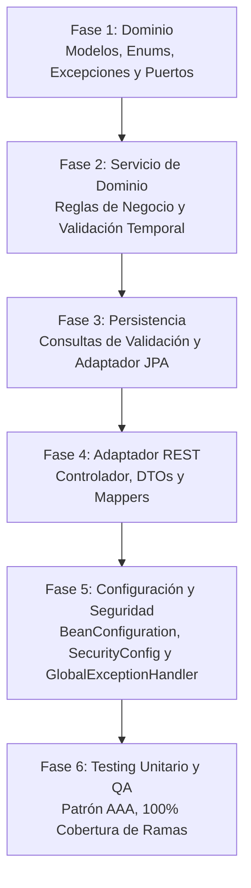

# 📋 Plan de Implementación · HU-19: Registro de Asistencia e Inasistencia de Citas

**Historia de Usuario:** HU-19  
**Módulo:** Gestión de Reservas y Cumplimiento  
**Rol:** Proveedor  
**Arquitectura:** Hexagonal (Ports & Adapters)  
**Proyecto:** Bookify

---

## 1. Definición de la Historia de Usuario

### 1.1 Enunciado
> **Como** proveedor,  
> **quiero** registrar si una cita finalizada fue atendida o si el cliente no asistió,  
> **para** mantener un historial confiable sobre el cumplimiento de mis reservas.

---

### 1.2 Criterios de Aceptación (Escenarios Gherkin)

```gherkin
Scenario: Registrar cita atendida
  Given que soy un proveedor autenticado
  And tengo una reserva confirmada cuya hora de finalización ya pasó
  When marco la cita como "atendida"
  Then el sistema actualiza su estado a "atendida"
  And guarda el registro de la operación

Scenario: Registrar inasistencia
  Given que soy un proveedor autenticado
  And tengo una reserva confirmada cuya hora de finalización ya pasó
  When marco la cita como "no asistió"
  Then el sistema actualiza su estado a "no asistió"
  And guarda el registro de la operación

Scenario: Impedir registrar asistencia anticipadamente
  Given que tengo una reserva que todavía no ha finalizado
  When intento marcarla como "atendida" o "no asistió"
  Then el sistema rechaza la operación
  And conserva el estado original

Scenario: Impedir clasificar reservas canceladas
  Given que tengo una reserva cancelada
  When intento marcarla como "atendida" o "no asistió"
  Then el sistema rechaza la operación

Scenario: Impedir modificar reservas de otro negocio
  Given que soy un proveedor autenticado
  When intento modificar la asistencia de una reserva no autorizada
  Then el sistema rechaza la operación
  And no modifica el estado de la reserva
```

---

## 2. Decisiones de Diseño y Alineación con `schema.sql`

El diseño se fundamenta estrictamente en la estructura definida en `schema.sql` y en los principios arquitectónicos del proyecto (**ADR-01: Arquitectura Hexagonal**, **ADR-02: Persistencia desacoplada**):

1. **Alineación con el Modelo Relacional (`schema.sql`):**
   * **`tbl_reserva`:** Cuenta con llaves foráneas directas hacia `id_servicio` (`tbl_servicio`), `id_disponibilidad` (`tbl_disponibilidad`), `id_cliente` (`tbl_usuario`) e `id_estado_reserva` (`tbl_estado_reserva`).
   * **Pertenencia del Proveedor:** `tbl_servicio` posee la columna `id_proveedor`. Por ende, la titularidad del comercio se valida de forma directa e inequívoca mediante `tbl_reserva.id_servicio -> tbl_servicio.id_proveedor`, o a través de `tbl_proveedor_usuario` para el usuario autenticado.
   * **Auditoría Transaccional (`tbl_historial_estado_reserva`):** Posee las columnas `id_reserva`, `id_estado_anterior`, `id_estado_nuevo`, `id_usuario_cambio` (FK a `tbl_usuario`), `motivo` y `fecha_cambio`. Se actualiza atómicamente con `tbl_reserva` utilizando el modelo `BookingStatusHistory`.
   * **Catálogo de Estados (`tbl_estado_reserva`):** Contiene `id_estado_reserva` (identity), `codigo` (unique), `nombre` y `descripcion`.
2. **Aislamiento del Dominio:** La lógica temporal (`now() > finAt`), la validación del estado anterior (`CONFIRMADA`), y la regla de no clasificar canceladas viven en el paquete `domain/service/` como código Java puro sin dependencias de Spring ni de JPA.
3. **Zona Horaria Estricta:** Las comparaciones temporales se evalúan en `ZoneId.of("America/Bogota")`, compatible con los campos `timestamp with time zone` de PostgreSQL.
4. **Seguridad y Aislamiento Multicomercio:** Se valida que el `id_proveedor` del servicio pertenezca al proveedor autenticado (`userId` $\rightarrow$ `tbl_proveedor_usuario`). Si difiere, se lanza `DomainForbiddenException` (HTTP 403 Forbidden).
5. **Endpoint REST propuesto:** 
   ```http
   PATCH /api/v1/comercio/reservas/{id}/asistencia
   ```
   *Razón:* Al ubicarse bajo `/api/v1/comercio/**`, queda cubierto por la regla existente en `SecurityConfig`: `.hasAuthority("PROVEEDOR")`.

---

## 3. Contratos de la API REST

### 3.1 Endpoint
* **Método:** `PATCH`
* **Ruta:** `/api/v1/comercio/reservas/{id}/asistencia`
* **Cabecera requerida:** `Authorization: Bearer <JWT_PROVEEDOR>`

### 3.2 Request Body (`AttendanceRequestDto`)
```json
{
  "estado": "ATENDIDA",
  "motivo": "Cita atendida en su totalidad"
}
```
* **Valores válidos para `estado`:** `"ATENDIDA"` o `"NO_ASISTIO"`.
* **Campo `motivo`:** Opcional (longitud máxima 255 caracteres).

### 3.3 Respuestas HTTP

| Código | Condición | Cuerpo de Respuesta (Ejemplo) |
|---|---|---|
| **200 OK** | Cita clasificada exitosamente | `{"reservaId": "...", "estado": "ATENDIDA", "fechaActualizacion": "...", "mensaje": "Asistencia registrada correctamente."}` |
| **400 Bad Request** | Cuerpo inválido, estado no reconocido o formato de UUID incorrecto | `{"error": "El estado debe ser 'ATENDIDA' o 'NO_ASISTIO'"}` |
| **401 Unauthorized** | Token JWT no suministrado o inválido | `HTTP 401 Unauthorized` |
| **403 Forbidden** | Proveedor intenta modificar una reserva de otro comercio | `{"error": "No está autorizado para modificar reservas de otro negocio."}` |
| **404 Not Found** | La reserva indicada no existe | `{"error": "No existe la reserva solicitada."}` |
| **409 Conflict** | La cita no ha finalizado aún, está cancelada o ya fue clasificada | `{"error": "No se puede registrar asistencia de una reserva que no ha finalizado."}` o `{"error": "No se puede registrar asistencia sobre una reserva cancelada."}` |

---

## 4. Fases de Implementación Paso a Paso



---

### Fase 1: Dominio (Modelos, Excepciones y Puertos)

1. **Definir Enumeración o Tipos de Asistencia:**
   * Archivo: `domain/model/AttendanceStatus.java`
     ```java
     package udea.fabrica.bookify.domain.model;
     public enum AttendanceStatus {
         ATENDIDA,
         NO_ASISTIO
     }
     ```

2. **Modelo de Comando de Registro:**
   * Archivo: `domain/model/RegisterAttendanceCommand.java`
     ```java
     package udea.fabrica.bookify.domain.model;
     import java.util.UUID;
     public record RegisterAttendanceCommand(
         UUID bookingId,
         UUID authenticatedUserId,
         AttendanceStatus status,
         String motivo
     ) {}
     ```

3. **Excepciones de Negocio:**
   * Reutilizar `BookingNotFoundException`, `DomainForbiddenException` y `DomainConflictException`.
   * (Opcional) Crear excepciones especializadas que extiendan de `DomainConflictException`:
     * `ReservationNotEndedException`: *"No se puede registrar asistencia de una reserva que aún no ha finalizado."*
     * `InvalidReservationStateException`: *"No se puede clasificar una reserva que se encuentra cancelada."*

4. **Puerto de Entrada (Caso de Uso):**
   * Archivo: `domain/port/in/RegisterAttendanceUseCase.java`
     ```java
     package udea.fabrica.bookify.domain.port.in;
     import udea.fabrica.bookify.domain.model.Booking;
     import udea.fabrica.bookify.domain.model.RegisterAttendanceCommand;

     public interface RegisterAttendanceUseCase {
         Booking registerAttendance(RegisterAttendanceCommand command);
     }
     ```

5. **Puerto de Salida (Repositorio):**
   * Extender `domain/port/out/BookingRepositoryPort.java` o crear `domain/port/out/AttendanceRepositoryPort.java`:
     ```java
     Optional<BookingAttendanceInfo> findAttendanceInfoById(UUID bookingId);
     void updateBookingStatus(UUID bookingId, Integer statusId, OffsetDateTime updatedAt);
     ```
   * Donde `BookingAttendanceInfo` transporta: `id`, `providerId`, `estadoCodigo`, `finAt`, `estadoId`.

---

### Fase 2: Servicio de Dominio (Lógica Pura de Negocio)

* **Archivo:** `domain/service/BookingAttendanceService.java`
* **Implementa:** `RegisterAttendanceUseCase`
* **Dependencias inyectadas por constructor:** `BookingRepositoryPort`, `MerchantProfileRepositoryPort` (o puerto de proveedor).

**Flujo del método `registerAttendance`:**
1. **Validación de Identidad del Proveedor:**
   * Obtener el `providerId` correspondiente al `authenticatedUserId`.
   * Si el usuario no tiene perfil comercial asociado $\rightarrow$ lanzar `DomainForbiddenException`.
2. **Existencia de la Reserva:**
   * Consultar la reserva por `command.bookingId()`.
   * Si no existe $\rightarrow$ lanzar `BookingNotFoundException("No existe la reserva solicitada.")`.
3. **Validación de Pertenencia (Aislamiento de Negocio):**
   * Verificar que `reserva.getProviderId().equals(providerId)`.
   * Si difieren $\rightarrow$ lanzar `DomainForbiddenException("No está autorizado para modificar reservas de otro negocio.")`.
4. **Validación de Estado Actual:**
   * Si el estado actual es `CANCELADA` $\rightarrow$ lanzar `DomainConflictException("No se puede registrar la asistencia de una reserva cancelada.")`.
   * Si el estado actual ya es `ATENDIDA` o `NO_ASISTIO` $\rightarrow$ lanzar `DomainConflictException("La asistencia de esta reserva ya fue registrada previamente.")`.
   * Si el estado no es `CONFIRMADA` $\rightarrow$ lanzar `DomainConflictException("Solo se puede registrar asistencia en reservas confirmadas.")`.
5. **Validación Temporal (Hora de Finalización):**
   * Obtener la fecha/hora actual en Colombia: `OffsetDateTime now = OffsetDateTime.now(ZoneId.of("America/Bogota"))`.
   * Verificar si `now.isBefore(reserva.getFinAt())`.
   * Si la cita no ha terminado $\rightarrow$ lanzar `DomainConflictException("No se puede registrar asistencia de una reserva que todavía no ha finalizado.")`.
6. **Transición y Auditoría:**
   * Obtener el identificador del nuevo estado (`findReservationStatusIdByCode(command.status().name())`).
   * Actualizar el estado de la reserva.
   * Registrar en el historial de estados (`tbl_historial_estado_reserva`):
     ```java
     BookingStatusHistory history = new BookingStatusHistory(
         reserva.getId(),
         reserva.getEstadoId(),
         newStatusId,
         command.authenticatedUserId(),
         command.motivo() != null ? command.motivo() : "Registro de asistencia: " + command.status().name(),
         now
     );
     bookingRepositoryPort.saveStatusHistory(history);
     ```
   * Retornar la reserva actualizada.

---

### Fase 3: Persistencia (Adaptador de Salida y Base de Datos)

1. **Estados en `tbl_estado_reserva`:**
   * Verificar/insertar en la base de datos (mediante script o `data.sql`):
     ```sql
     INSERT INTO tbl_estado_reserva (codigo, nombre, descripcion)
     VALUES 
       ('ATENDIDA', 'Atendida', 'La cita fue cumplida y el cliente asistió'),
       ('NO_ASISTIO', 'No Asistió', 'El cliente no se presentó a la cita')
     ON CONFLICT (codigo) DO NOTHING;
     ```

2. **Consulta de Reserva con Proveedor y Horario (Basada en `schema.sql`):**
   * Aprovechando que `tbl_reserva` cuenta directamente con `id_servicio` (FK hacia `tbl_servicio`) y `id_disponibilidad` (FK hacia `tbl_disponibilidad`), la consulta obtiene los datos de validación de forma directa y óptima:
     ```sql
     SELECT 
       r.id_reserva,
       s.id_proveedor,
       er.codigo AS estado_codigo,
       er.id_estado_reserva,
       d.fin_at
     FROM tbl_reserva r
     INNER JOIN tbl_servicio s ON s.id_servicio = r.id_servicio
     INNER JOIN tbl_disponibilidad d ON d.id_disponibilidad = r.id_disponibilidad
     INNER JOIN tbl_estado_reserva er ON er.id_estado_reserva = r.id_estado_reserva
     WHERE r.id_reserva = :reservaId;
     ```

3. **Adaptador de Persistencia:**
   * Implementar en `BookingPersistenceAdapter.java` los métodos necesarios utilizando `EntityManager` o Spring Data JPA.

---

### Fase 4: Adaptador REST (Controlador, DTOs y Mappers)

1. **DTOs de Entrada y Salida:**
   * `AttendanceRequestDto.java`:
     ```java
     public record AttendanceRequestDto(
         @NotNull(message = "El estado es obligatorio")
         @Pattern(regexp = "^(ATENDIDA|NO_ASISTIO)$", message = "El estado debe ser 'ATENDIDA' o 'NO_ASISTIO'")
         String estado,

         @Size(max = 255, message = "El motivo no puede exceder 255 caracteres")
         String motivo
     ) {}
     ```
   * `AttendanceResponseDto.java`:
     ```java
     public record AttendanceResponseDto(
         UUID reservaId,
         String estado,
         OffsetDateTime fechaActualizacion,
         String mensaje
     ) {}
     ```

2. **Controlador REST:**
   * Archivo: `infrastructure/adapter/input/rest/controller/MerchantBookingAttendanceController.java`
     ```java
     @RestController
     @RequestMapping("/api/v1/comercio/reservas")
     public class MerchantBookingAttendanceController {

         private final RegisterAttendanceUseCase registerAttendanceUseCase;

         public MerchantBookingAttendanceController(RegisterAttendanceUseCase useCase) {
             this.registerAttendanceUseCase = useCase;
         }

         @PatchMapping("/{id}/asistencia")
         public ResponseEntity<AttendanceResponseDto> registerAttendance(
                 @PathVariable("id") UUID id,
                 @Valid @RequestBody AttendanceRequestDto request,
                 Authentication authentication) {

             UUID userId = UUID.fromString(authentication.getName());
             RegisterAttendanceCommand command = new RegisterAttendanceCommand(
                 id,
                 userId,
                 AttendanceStatus.valueOf(request.estado()),
                 request.motivo()
             );

             Booking updated = registerAttendanceUseCase.registerAttendance(command);

             return ResponseEntity.ok(new AttendanceResponseDto(
                 updated.getId(),
                 request.estado(),
                 updated.getFechaActualizacion(),
                 "Asistencia registrada correctamente."
             ));
         }
     }
     ```

---

### Fase 5: Configuración y Seguridad

1. **Registro del Bean en `BeanConfiguration.java`:**
   ```java
   @Bean
   public RegisterAttendanceUseCase registerAttendanceUseCase(
           BookingRepositoryPort bookingRepository,
           MerchantProfileRepositoryPort merchantProfileRepository) {
       return new BookingAttendanceService(bookingRepository, merchantProfileRepository);
   }
   ```

2. **Actualización de `SecurityConfig.java`:**
   * Garantizar que la ruta `/api/v1/comercio/**` exija la autoridad `PROVEEDOR`:
     ```java
     .requestMatchers("/api/v1/disponibilidades/**",
                      "/api/v1/comercio/**",
                      "/api/v1/dias-no-laborables/**").hasAuthority("PROVEEDOR")
     ```

3. **Verificación en `GlobalExceptionHandler.java`:**
   * Confirmar que `DomainConflictException` retorne **409 Conflict** y `DomainForbiddenException` retorne **403 Forbidden** con el formato JSON estándar:
     ```json
     { "error": "mensaje descriptivo" }
     ```

---

## 5. Matriz de Trazabilidad: Escenarios Gherkin vs Pruebas

| Escenario Gherkin | Clase de Prueba | Método de Prueba | HTTP Status Esperado | Verificación de Estado / Efecto |
|---|---|---|---|---|
| **Registrar cita atendida** | `BookingAttendanceServiceTest` / `MerchantBookingAttendanceControllerTest` | `shouldRegisterAttendedSuccessfully` | `200 OK` | `estadoReserva` pasa a `ATENDIDA`, `saveStatusHistory` invocado con motivo y usuario. |
| **Registrar inasistencia** | `BookingAttendanceServiceTest` / `MerchantBookingAttendanceControllerTest` | `shouldRegisterNoShowSuccessfully` | `200 OK` | `estadoReserva` pasa a `NO_ASISTIO`, registro de historial guardado en BD. |
| **Impedir asistencia anticipada** | `BookingAttendanceServiceTest` | `shouldRejectWhenReservationNotEnded` | `409 Conflict` | Lanza `DomainConflictException`. No se modifica el estado de la reserva. |
| **Impedir clasificar canceladas** | `BookingAttendanceServiceTest` | `shouldRejectWhenReservationIsCancelled` | `409 Conflict` | Lanza `DomainConflictException`. Estado se conserva como `CANCELADA`. |
| **Impedir modificar otro negocio** | `BookingAttendanceServiceTest` | `shouldRejectWhenBookingBelongsToAnotherProvider` | `403 Forbidden` | Lanza `DomainForbiddenException`. Sin llamadas a actualizar o guardar historial. |
| **Reserva inexistente** | `BookingAttendanceServiceTest` | `shouldFailWhenBookingNotFound` | `404 Not Found` | Lanza `BookingNotFoundException`. |

---

## 6. Estrategia de Testing y Verificación de Calidad

### 6.1 Pruebas Unitarias (JUnit 5 + Mockito + AAA)
* Crear `src/test/java/udea/fabrica/bookify/domain/service/BookingAttendanceServiceTest.java`.
* Estructurar cada prueba con comentarios explícitos `// Arrange`, `// Act`, `// Assert`.
* Probar límites temporales exactos (`endAt.minusSeconds(1)` vs `endAt.plusSeconds(1)`).
* Cobertura objetivo: **100% de ramas** sobre el nuevo caso de uso y controlador.

### 6.2 Pruebas de Integración y Colección Postman (QA)
* Diseñar la colección `Bookify-HU19-Asistencia.postman_collection.json` con las siguientes pruebas:
  1. `CP-HU19-01`: Registro exitoso de cita atendida con hora de fin pasada $\rightarrow$ valida HTTP 200 y body.
  2. `CP-HU19-02`: Registro de inasistencia con hora de fin pasada $\rightarrow$ valida HTTP 200 y body.
  3. `CP-HU19-03`: Intento de registrar cita en curso o futura $\rightarrow$ valida HTTP 409 y mensaje de cita no finalizada.
  4. `CP-HU19-04`: Intento de clasificar cita previamente cancelada $\rightarrow$ valida HTTP 409 y estado inalterado.
  5. `CP-HU19-05`: Proveedor B intenta marcar asistencia de cita del Proveedor A $\rightarrow$ valida HTTP 403.
  6. `CP-HU19-06`: Token con rol CLIENTE intenta invocar el endpoint $\rightarrow$ valida HTTP 403 / 401.

### 6.3 Verificación de Reglas SonarCloud
* Verificar que no se introduzcan cadenas literales duplicadas (`java:S1192`).
* Usar `ZoneId.of("America/Bogota")` en `now()` para evitar `java:S8688`.
* Mantener la complejidad ciclomática del nuevo servicio por debajo de 10.

---

## 7. Plan de Pruebas de Endpoints (Casos de Prueba con Datos y Resultados Esperados)

### 7.1 Requisitos y Precondiciones del Entorno

1. **Variables de Postman / Entorno:**
   * `baseUrl`: `http://localhost:8080` (o ambiente de despliegue en Render).
   * `tokenProveedorA`: Token JWT con rol `PROVEEDOR` perteneciente al comercio A.
   * `tokenProveedorB`: Token JWT con rol `PROVEEDOR` perteneciente a un comercio distinto B.
   * `tokenCliente`: Token JWT con rol `CLIENTE`.

2. **Obtención de Tokens vía Login:**
   ```bash
   # Proveedor A
   curl -X POST "{{baseUrl}}/api/v1/auth/login" \
     -H "Content-Type: application/json" \
     -d '{"correo": "proveedorA@bookify.com", "password": "Password123*"}'

   # Proveedor B
   curl -X POST "{{baseUrl}}/api/v1/auth/login" \
     -H "Content-Type: application/json" \
     -d '{"correo": "proveedorB@bookify.com", "password": "Password123*"}'

   # Cliente
   curl -X POST "{{baseUrl}}/api/v1/auth/login" \
     -H "Content-Type: application/json" \
     -d '{"correo": "cliente@bookify.com", "password": "Password123*"}'
   ```

3. **Script SQL de Datos de Prueba (Verificación o Inserción):**
   ```sql
   -- Asegurar estados requeridos en tbl_estado_reserva
   INSERT INTO public.tbl_estado_reserva (codigo, nombre, descripcion)
   VALUES
     ('CONFIRMADA', 'Confirmada', 'Reserva confirmada'),
     ('CANCELADA',  'Cancelada',  'Reserva cancelada'),
     ('ATENDIDA',   'Atendida',   'La cita fue cumplida y el cliente asistió'),
     ('NO_ASISTIO', 'No Asistió', 'El cliente no se presentó a la cita')
   ON CONFLICT (codigo) DO NOTHING;

   -- Consultar reservas de prueba con su horario de fin y estado para el Proveedor A:
   SELECT 
     r.id_reserva,
     s.id_proveedor,
     p.nombre_comercial,
     er.codigo AS estado,
     d.inicio_at,
     d.fin_at,
     (d.fin_at < now()) AS ya_finalizo
   FROM tbl_reserva r
   JOIN tbl_servicio s ON s.id_servicio = r.id_servicio
   JOIN tbl_proveedor p ON p.id_proveedor = s.id_proveedor
   JOIN tbl_disponibilidad d ON d.id_disponibilidad = r.id_disponibilidad
   JOIN tbl_estado_reserva er ON er.id_estado_reserva = r.id_estado_reserva
   ORDER BY d.inicio_at DESC;
   ```

---

### 7.2 Casos de Prueba Detallados

#### CP-HU19-01 · Registrar cita atendida exitosamente
* **Escenario Gherkin:** *Registrar cita atendida*
* **Precondición:** Reserva `id_reserva = "11111111-1111-1111-1111-111111111111"` en estado `CONFIRMADA`, pertenece al comercio de `tokenProveedorA`, y `fin_at` es anterior a la hora actual (`fin_at < now()`).
* **Petición HTTP:**
  ```http
  PATCH {{baseUrl}}/api/v1/comercio/reservas/11111111-1111-1111-1111-111111111111/asistencia
  Authorization: Bearer {{tokenProveedorA}}
  Content-Type: application/json

  {
    "estado": "ATENDIDA",
    "motivo": "Cliente asistió puntualmente a su cita."
  }
  ```
* **Comando curl:**
  ```bash
  curl -X PATCH "{{baseUrl}}/api/v1/comercio/reservas/11111111-1111-1111-1111-111111111111/asistencia" \
    -H "Authorization: Bearer {{tokenProveedorA}}" \
    -H "Content-Type: application/json" \
    -d '{"estado": "ATENDIDA", "motivo": "Cliente asistió puntualmente a su cita."}'
  ```
* **Resultado Esperado:**
  * **Código HTTP:** `200 OK`
  * **Cuerpo de Respuesta:**
    ```json
    {
      "reservaId": "11111111-1111-1111-1111-111111111111",
      "estado": "ATENDIDA",
      "fechaActualizacion": "2026-11-14T22:15:00Z",
      "mensaje": "Asistencia registrada correctamente."
    }
    ```
  * **Verificación en BD:**
    * `tbl_reserva.id_estado_reserva` cambia al ID de `ATENDIDA`.
    * Se crea registro en `tbl_historial_estado_reserva` con `estado_anterior_id = <ID_CONFIRMADA>`, `estado_nuevo_id = <ID_ATENDIDA>`, y `motivo = "Cliente asistió puntualmente a su cita."`.

---

#### CP-HU19-02 · Registrar inasistencia exitosamente
* **Escenario Gherkin:** *Registrar inasistencia*
* **Precondición:** Reserva `id_reserva = "22222222-2222-2222-2222-222222222222"` en estado `CONFIRMADA`, pertenece al comercio de `tokenProveedorA`, y `fin_at < now()`.
* **Petición HTTP:**
  ```http
  PATCH {{baseUrl}}/api/v1/comercio/reservas/22222222-2222-2222-2222-222222222222/asistencia
  Authorization: Bearer {{tokenProveedorA}}
  Content-Type: application/json

  {
    "estado": "NO_ASISTIO",
    "motivo": "El cliente no se presentó ni notificó cancelación."
  }
  ```
* **Comando curl:**
  ```bash
  curl -X PATCH "{{baseUrl}}/api/v1/comercio/reservas/22222222-2222-2222-2222-222222222222/asistencia" \
    -H "Authorization: Bearer {{tokenProveedorA}}" \
    -H "Content-Type: application/json" \
    -d '{"estado": "NO_ASISTIO", "motivo": "El cliente no se presentó ni notificó cancelación."}'
  ```
* **Resultado Esperado:**
  * **Código HTTP:** `200 OK`
  * **Cuerpo de Respuesta:**
    ```json
    {
      "reservaId": "22222222-2222-2222-2222-222222222222",
      "estado": "NO_ASISTIO",
      "fechaActualizacion": "2026-11-14T22:16:00Z",
      "mensaje": "Asistencia registrada correctamente."
    }
    ```
  * **Verificación en BD:**
    * `tbl_reserva.id_estado_reserva` cambia al ID de `NO_ASISTIO`.
    * Registro creado en `tbl_historial_estado_reserva` con nuevo estado `NO_ASISTIO`.

---

#### CP-HU19-03 · Impedir registrar asistencia anticipadamente
* **Escenario Gherkin:** *Impedir registrar asistencia anticipadamente*
* **Precondición:** Reserva `id_reserva = "33333333-3333-3333-3333-333333333333"` en estado `CONFIRMADA` pero cuya hora de finalización es futura (`fin_at > now()`, ej. `2026-12-01T15:00:00Z`).
* **Petición HTTP:**
  ```http
  PATCH {{baseUrl}}/api/v1/comercio/reservas/33333333-3333-3333-3333-333333333333/asistencia
  Authorization: Bearer {{tokenProveedorA}}
  Content-Type: application/json

  {
    "estado": "ATENDIDA"
  }
  ```
* **Comando curl:**
  ```bash
  curl -X PATCH "{{baseUrl}}/api/v1/comercio/reservas/33333333-3333-3333-3333-333333333333/asistencia" \
    -H "Authorization: Bearer {{tokenProveedorA}}" \
    -H "Content-Type: application/json" \
    -d '{"estado": "ATENDIDA"}'
  ```
* **Resultado Esperado:**
  * **Código HTTP:** `409 Conflict`
  * **Cuerpo de Respuesta:**
    ```json
    {
      "error": "No se puede registrar asistencia de una reserva que todavía no ha finalizado."
    }
    ```
  * **Verificación en BD:** El estado de la reserva permanece inalterado en `CONFIRMADA`. No se genera entrada en el historial.

---

#### CP-HU19-04 · Impedir clasificar reservas canceladas
* **Escenario Gherkin:** *Impedir clasificar reservas canceladas*
* **Precondición:** Reserva `id_reserva = "44444444-4444-4444-4444-444444444444"` que ya fue cancelada (`er.codigo = 'CANCELADA'`).
* **Petición HTTP:**
  ```http
  PATCH {{baseUrl}}/api/v1/comercio/reservas/44444444-4444-4444-4444-444444444444/asistencia
  Authorization: Bearer {{tokenProveedorA}}
  Content-Type: application/json

  {
    "estado": "NO_ASISTIO"
  }
  ```
* **Comando curl:**
  ```bash
  curl -X PATCH "{{baseUrl}}/api/v1/comercio/reservas/44444444-4444-4444-4444-444444444444/asistencia" \
    -H "Authorization: Bearer {{tokenProveedorA}}" \
    -H "Content-Type: application/json" \
    -d '{"estado": "NO_ASISTIO"}'
  ```
* **Resultado Esperado:**
  * **Código HTTP:** `409 Conflict`
  * **Cuerpo de Respuesta:**
    ```json
    {
      "error": "No se puede registrar la asistencia de una reserva cancelada."
    }
    ```
  * **Verificación en BD:** El estado se mantiene en `CANCELADA`.

---

#### CP-HU19-05 · Impedir modificar reservas de otro negocio (Aislamiento Multicomercio)
* **Escenario Gherkin:** *Impedir modificar reservas de otro negocio*
* **Precondición:** Reserva `id_reserva = "11111111-1111-1111-1111-111111111111"` pertenece al Proveedor A. El usuario autenticado es el Proveedor B (`tokenProveedorB`).
* **Petición HTTP:**
  ```http
  PATCH {{baseUrl}}/api/v1/comercio/reservas/11111111-1111-1111-1111-111111111111/asistencia
  Authorization: Bearer {{tokenProveedorB}}
  Content-Type: application/json

  {
    "estado": "ATENDIDA"
  }
  ```
* **Comando curl:**
  ```bash
  curl -X PATCH "{{baseUrl}}/api/v1/comercio/reservas/11111111-1111-1111-1111-111111111111/asistencia" \
    -H "Authorization: Bearer {{tokenProveedorB}}" \
    -H "Content-Type: application/json" \
    -d '{"estado": "ATENDIDA"}'
  ```
* **Resultado Esperado:**
  * **Código HTTP:** `403 Forbidden`
  * **Cuerpo de Respuesta:**
    ```json
    {
      "error": "No está autorizado para modificar reservas de otro negocio."
    }
    ```
  * **Verificación en BD:** La reserva del Proveedor A permanece intacta.

---

#### CP-HU19-06 · Impedir reclasificar citas ya marcadas
* **Precondición:** Reserva `id_reserva = "11111111-1111-1111-1111-111111111111"` ya fue clasificada como `ATENDIDA` en CP-HU19-01.
* **Petición HTTP:**
  ```http
  PATCH {{baseUrl}}/api/v1/comercio/reservas/11111111-1111-1111-1111-111111111111/asistencia
  Authorization: Bearer {{tokenProveedorA}}
  Content-Type: application/json

  {
    "estado": "NO_ASISTIO"
  }
  ```
* **Resultado Esperado:**
  * **Código HTTP:** `409 Conflict`
  * **Cuerpo de Respuesta:**
    ```json
    {
      "error": "La asistencia de esta reserva ya fue registrada previamente."
    }
    ```

---

#### CP-HU19-07 · Error de validación en el cuerpo (Estado inválido)
* **Petición HTTP:**
  ```http
  PATCH {{baseUrl}}/api/v1/comercio/reservas/11111111-1111-1111-1111-111111111111/asistencia
  Authorization: Bearer {{tokenProveedorA}}
  Content-Type: application/json

  {
    "estado": "PRESENTE"
  }
  ```
* **Resultado Esperado:**
  * **Código HTTP:** `400 Bad Request`
  * **Cuerpo de Respuesta:** Contiene mensaje de validación indicando que el estado debe ser `ATENDIDA` o `NO_ASISTIO`.

---

#### CP-HU19-08 · Reserva inexistente
* **Petición HTTP:**
  ```http
  PATCH {{baseUrl}}/api/v1/comercio/reservas/00000000-0000-0000-0000-000000000000/asistencia
  Authorization: Bearer {{tokenProveedorA}}
  Content-Type: application/json

  {
    "estado": "ATENDIDA"
  }
  ```
* **Resultado Esperado:**
  * **Código HTTP:** `404 Not Found`
  * **Cuerpo de Respuesta:**
    ```json
    {
      "error": "No existe la reserva solicitada."
    }
    ```

---

#### CP-HU19-09 · Control de acceso - Cliente intenta registrar asistencia
* **Petición HTTP:** Con `Authorization: Bearer {{tokenCliente}}`.
* **Resultado Esperado:**
  * **Código HTTP:** `403 Forbidden`

---

#### CP-HU19-10 · Petición no autenticada
* **Petición HTTP:** Sin cabecera `Authorization`.
* **Resultado Esperado:**
  * **Código HTTP:** `401 Unauthorized`


