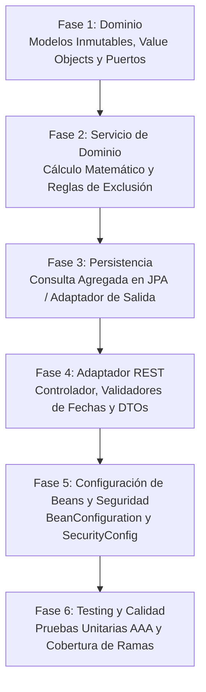

# 📋 Plan de Implementación · HU-21: Visualización de Tasa de Inasistencias de Citas

**Historia de Usuario:** HU-21  
**Módulo:** Métricas y Reportería de Proveedor  
**Rol:** Proveedor  
**Arquitectura:** Hexagonal (Ports & Adapters)  
**Proyecto:** Bookify

---

## 1. Definición de la Historia de Usuario

### 1.1 Enunciado
> **Como** proveedor,  
> **quiero** visualizar la tasa de inasistencias de las citas finalizadas en un periodo,  
> **para** identificar problemas de asistencia y evaluar medidas preventivas.

---

### 1.2 Criterios de Aceptación (Escenarios Gherkin)

```gherkin
Scenario: Calcular tasa de inasistencias
  Given que en el periodo existen 45 citas atendidas
  And existen 5 citas marcadas como "no asistió"
  When consulto las métricas de inasistencia
  Then el sistema muestra una tasa de inasistencia del 10%
  And presenta un total de 5 inasistencias

Scenario: Excluir reservas canceladas
  Given que existen reservas canceladas en el periodo
  When consulto las métricas de inasistencia
  Then el sistema excluye las reservas canceladas del cálculo

Scenario: Excluir citas pendientes de clasificación
  Given que existen citas pasadas todavía confirmadas
  When consulto las métricas de inasistencia
  Then el sistema no las incluye en la tasa
  And informa cuántas están pendientes de clasificación

Scenario: Consultar periodo sin citas clasificadas
  Given que no existen citas atendidas ni no asistidas
  When consulto las métricas del periodo
  Then el sistema muestra "Sin datos suficientes"
```

---

### 1.3 Regla Matemática y de Negocio

La tasa de inasistencia se calcula **exclusivamente sobre las citas finalizadas y clasificadas**:

$$\text{Tasa de Inasistencia (\%)} = \left( \frac{\text{Citas no asistidas}}{\text{Citas atendidas} + \text{Citas no asistidas}} \right) \times 100$$

#### Reglas de Exclusión e Inclusión:
1. **Universo de Clasificadas:** Solo entran al cálculo las reservas con estado `ATENDIDA` y `NO_ASISTIO`.
2. **Exclusión de Canceladas:** Las reservas con estado `CANCELADA` **no forman parte** ni del numerador ni del denominador.
3. **Exclusión de Pendientes:** Las citas finalizadas (`fin_at < now()`) que aún permanezcan en estado `CONFIRMADA` **no se incluyen** en el cálculo de la tasa, pero deben contabilizarse e informarse en el campo `pendientesClasificacion`.
4. **Citas Futuras:** Citas programadas cuya fecha/hora de fin es futura (`fin_at >= now()`) no son citas finalizadas; se ignoran en las métricas de cumplimiento.
5. **Periodos Vacíos / Sin Datos:** Si $\text{Citas atendidas} + \text{Citas no asistidas} = 0$, la tasa no es calculable (indeterminación $0/0$); el sistema debe responder con `tasaInasistencia = null` y el mensaje explícito `"Sin datos suficientes"`.

---

## 2. Decisiones de Diseño y Alineación con `schema.sql`

El diseño se ajusta estrictamente a las definiciones de tablas, columnas y llaves foráneas contenidas en `schema.sql`:

1. **Alineación con el Modelo Relacional (`schema.sql`):**
   * **`tbl_reserva`:** Cuenta con `id_servicio` (FK a `tbl_servicio`), `id_disponibilidad` (FK a `tbl_disponibilidad`), e `id_estado_reserva` (FK a `tbl_estado_reserva`).
   * **`tbl_servicio`:** Contiene `id_proveedor` (FK a `tbl_proveedor`), permitiendo filtrar las reservas del proveedor mediante un `INNER JOIN` directo entre `tbl_reserva` y `tbl_servicio`.
   * **`tbl_disponibilidad`:** Contiene los campos temporales `inicio_at` y `fin_at` de tipo `timestamp with time zone`. Las citas de un periodo se filtran por `d.inicio_at >= :startDateTime AND d.inicio_at <= :endDateTime`.
   * **`tbl_proveedor_usuario`:** Vincula al usuario autenticado (`id_usuario`) con su comercio (`id_proveedor`), garantizando el aislamiento multicomercio.
2. **Aislamiento del Dominio (ADR-01):** La fórmula matemática, las validaciones de rango temporal y la condición de "Sin datos suficientes" residen en un servicio de dominio puro (`domain/service/AttendanceMetricsService.java`), desacoplado de bases de datos y frameworks.
3. **Zona Horaria Oficial:** La evaluación de citas finalizadas (`fin_at < now`) se realiza contra la zona horaria del sistema de reservas: `ZoneId.of("America/Bogota")`.
4. **Precisión Numérica:** La tasa porcentual se maneja con `BigDecimal` redondeada a 2 decimales (`RoundingMode.HALF_UP`) en el dominio.
5. **Endpoint REST propuesto:**
   ```http
   GET /api/v1/comercio/metricas/inasistencias?fechaInicio=2026-10-01&fechaFin=2026-10-31
   ```
   *Razón:* Al encontrarse en `/api/v1/comercio/**`, aprovecha la autorización existente en `SecurityConfig`: `.hasAuthority("PROVEEDOR")`.

---

## 3. Contratos de la API REST

### 3.1 Endpoint
* **Método:** `GET`
* **Ruta:** `/api/v1/comercio/metricas/inasistencias`
* **Cabecera requerida:** `Authorization: Bearer <JWT_PROVEEDOR>`
* **Parámetros de consulta (Query Params):**
  * `fechaInicio` (obligatorio, formato `YYYY-MM-DD`, ej. `2026-10-01`)
  * `fechaFin` (obligatorio, formato `YYYY-MM-DD`, ej. `2026-10-31`)

---

### 3.2 Respuestas HTTP

#### Caso A: Con citas clasificadas (Escenarios 1, 2 y 3) — `200 OK`
```json
{
  "proveedorId": "c3b9b46e-1d52-4756-8a03-75c1284d7201",
  "fechaInicio": "2026-10-01",
  "fechaFin": "2026-10-31",
  "citasAtendidas": 45,
  "citasNoAsistidas": 5,
  "totalClasificadas": 50,
  "tasaInasistencia": 10.00,
  "pendientesClasificacion": 3,
  "mensaje": null
}
```

#### Caso B: Sin citas clasificadas en el periodo (Escenario 4) — `200 OK`
```json
{
  "proveedorId": "c3b9b46e-1d52-4756-8a03-75c1284d7201",
  "fechaInicio": "2026-10-01",
  "fechaFin": "2026-10-31",
  "citasAtendidas": 0,
  "citasNoAsistidas": 0,
  "totalClasificadas": 0,
  "tasaInasistencia": null,
  "pendientesClasificacion": 2,
  "mensaje": "Sin datos suficientes"
}
```

#### Caso C: Errores de Validación o Autorización
* **`400 Bad Request`:** Si `fechaInicio > fechaFin` o parámetros ausentes/con formato inválido:
  ```json
  { "error": "La fecha de inicio no puede ser posterior a la fecha de fin" }
  ```
* **`401 Unauthorized`:** Token ausente o expirado.
* **`403 Forbidden`:** Usuario autenticado no tiene rol `PROVEEDOR` o carece de perfil comercial registrado.

---

## 4. Fases de Implementación Paso a Paso



---

### Fase 1: Dominio (Modelos y Puertos)

1. **Modelo de Filtro de Consulta:**
   * Archivo: `domain/model/AttendanceMetricsFilter.java`
     ```java
     package udea.fabrica.bookify.domain.model;
     import java.time.LocalDate;
     import java.util.UUID;

     public record AttendanceMetricsFilter(
         UUID providerId,
         LocalDate fechaInicio,
         LocalDate fechaFin
     ) {
         public AttendanceMetricsFilter {
             if (providerId == null) throw new IllegalArgumentException("El proveedor es requerido.");
             if (fechaInicio == null || fechaFin == null) throw new IllegalArgumentException("Las fechas de inicio y fin son requeridas.");
             if (fechaInicio.isAfter(fechaFin)) throw new IllegalArgumentException("La fecha de inicio no puede ser posterior a la fecha de fin.");
         }
     }
     ```

2. **Modelo de Métricas de Dominio:**
   * Archivo: `domain/model/AttendanceMetrics.java`
     ```java
     package udea.fabrica.bookify.domain.model;
     import java.math.BigDecimal;
     import java.time.LocalDate;
     import java.util.UUID;

     public record AttendanceMetrics(
         UUID providerId,
         LocalDate fechaInicio,
         LocalDate fechaFin,
         long citasAtendidas,
         long citasNoAsistidas,
         long totalClasificadas,
         BigDecimal tasaInasistencia,
         long pendientesClasificacion,
         String mensaje
     ) {}
     ```

3. **Modelo de Agregación de Datos Crudos de Persistencia:**
   * Archivo: `domain/model/AttendancePeriodSummary.java`
     ```java
     package udea.fabrica.bookify.domain.model;

     public record AttendancePeriodSummary(
         long atendidas,
         long noAsistidas,
         long canceladas,
         long confirmadasPasadas
     ) {}
     ```

4. **Puerto de Entrada (Caso de Uso):**
   * Archivo: `domain/port/in/GetAttendanceMetricsUseCase.java`
     ```java
     package udea.fabrica.bookify.domain.port.in;
     import java.time.LocalDate;
     import java.util.UUID;
     import udea.fabrica.bookify.domain.model.AttendanceMetrics;

     public interface GetAttendanceMetricsUseCase {
         AttendanceMetrics getMetrics(UUID authenticatedUserId, LocalDate fechaInicio, LocalDate fechaFin);
     }
     ```

5. **Puerto de Salida (Repositorio):**
   * Archivo: `domain/port/out/AttendanceMetricsOutputPort.java`
     ```java
     package udea.fabrica.bookify.domain.port.out;
     import java.time.OffsetDateTime;
     import java.util.UUID;
     import udea.fabrica.bookify.domain.model.AttendancePeriodSummary;

     public interface AttendanceMetricsOutputPort {
         AttendancePeriodSummary getPeriodSummary(
             UUID providerId,
             OffsetDateTime startDateTime,
             OffsetDateTime endDateTime,
             OffsetDateTime now
         );
     }
     ```

---

### Fase 2: Servicio de Dominio (Lógica Pura de Cálculo)

* **Archivo:** `domain/service/AttendanceMetricsService.java`
* **Implementa:** `GetAttendanceMetricsUseCase`
* **Dependencias:** `AttendanceMetricsOutputPort`, `MerchantProfileRepositoryPort`

**Algoritmo del Caso de Uso:**
```java
public AttendanceMetrics getMetrics(UUID authenticatedUserId, LocalDate fechaInicio, LocalDate fechaFin) {
    // 1. Resolver el comercio del usuario autenticado
    MerchantProfile profile = merchantProfileRepository.findByUserId(authenticatedUserId)
            .orElseThrow(() -> new DomainForbiddenException("El usuario no tiene un perfil comercial registrado."));
    UUID providerId = profile.getId();

    // 2. Validar rango de fechas (mediante el Value Object AttendanceMetricsFilter)
    AttendanceMetricsFilter filter = new AttendanceMetricsFilter(providerId, fechaInicio, fechaFin);

    // 3. Normalizar límites temporales a OffsetDateTime (America/Bogota)
    ZoneId zone = ZoneId.of("America/Bogota");
    OffsetDateTime startDateTime = filter.fechaInicio().atStartOfDay(zone).toOffsetDateTime();
    OffsetDateTime endDateTime = filter.fechaFin().atTime(LocalTime.MAX).atZone(zone).toOffsetDateTime();
    OffsetDateTime now = OffsetDateTime.now(zone);

    // 4. Obtener datos crudos desde el puerto de salida
    AttendancePeriodSummary summary = metricsOutputPort.getPeriodSummary(providerId, startDateTime, endDateTime, now);

    long atendidas = summary.atendidas();
    long noAsistidas = summary.noAsistidas();
    long totalClasificadas = atendidas + noAsistidas;
    long pendientes = summary.confirmadasPasadas();

    // 5. Aplicar lógica de tasa y mensaje
    if (totalClasificadas == 0) {
        return new AttendanceMetrics(
            providerId,
            filter.fechaInicio(),
            filter.fechaFin(),
            0,
            0,
            0,
            null,
            pendientes,
            "Sin datos suficientes"
        );
    }

    BigDecimal noAsistidasBd = BigDecimal.valueOf(noAsistidas);
    BigDecimal totalBd = BigDecimal.valueOf(totalClasificadas);
    BigDecimal tasa = noAsistidasBd
            .multiply(BigDecimal.valueOf(100))
            .divide(totalBd, 2, RoundingMode.HALF_UP);

    return new AttendanceMetrics(
        providerId,
        filter.fechaInicio(),
        filter.fechaFin(),
        atendidas,
        noAsistidas,
        totalClasificadas,
        tasa,
        pendientes,
        null
    );
}
```

---

### Fase 3: Persistencia (Adaptador de Salida y Consultas SQL)

1. **Consulta Agregada en Base de Datos (Alineada con `schema.sql`):**
   Para obtener el resumen del periodo en **una sola consulta atómica**, sin cargar entidades a memoria, uniendo directamente `tbl_reserva` con `tbl_servicio`, `tbl_disponibilidad` y `tbl_estado_reserva`:
   ```sql
   SELECT 
       COUNT(CASE WHEN er.codigo = 'ATENDIDA' THEN 1 END) AS atendidas,
       COUNT(CASE WHEN er.codigo = 'NO_ASISTIO' THEN 1 END) AS no_asistidas,
       COUNT(CASE WHEN er.codigo = 'CANCELADA' THEN 1 END) AS canceladas,
       COUNT(CASE WHEN er.codigo = 'CONFIRMADA' AND d.fin_at < :now THEN 1 END) AS confirmadas_pasadas
   FROM tbl_reserva r
   INNER JOIN tbl_servicio s ON s.id_servicio = r.id_servicio
   INNER JOIN tbl_disponibilidad d ON d.id_disponibilidad = r.id_disponibilidad
   INNER JOIN tbl_estado_reserva er ON er.id_estado_reserva = r.id_estado_reserva
   WHERE s.id_proveedor = :proveedorId
     AND d.inicio_at >= :startDateTime
     AND d.inicio_at <= :endDateTime;
   ```

2. **Proyección Spring Data JPA:**
   * Archivo: `infrastructure/adapter/output/persistence/repository/AttendanceMetricsProjection.java`
     ```java
     public interface AttendanceMetricsProjection {
         long getAtendidas();
         long getNoAsistidas();
         long getCanceladas();
         long getConfirmadasPasadas();
     }
     ```

3. **Adaptador de Persistencia:**
   * Archivo: `infrastructure/adapter/output/persistence/adapter/AttendanceMetricsPersistenceAdapter.java`
   * Implementa `AttendanceMetricsOutputPort` mapeando la proyección a `AttendancePeriodSummary`.

---

### Fase 4: Adaptador REST (Controlador y DTOs)

1. **DTO de Respuesta REST:**
   * Archivo: `infrastructure/adapter/input/rest/dto/response/AttendanceMetricsResponseDto.java`
     ```java
     public record AttendanceMetricsResponseDto(
         UUID proveedorId,
         LocalDate fechaInicio,
         LocalDate fechaFin,
         long citasAtendidas,
         long citasNoAsistidas,
         long totalClasificadas,
         BigDecimal tasaInasistencia,
         long pendientesClasificacion,
         String mensaje
     ) {}
     ```

2. **Mapper REST:**
   * Archivo: `infrastructure/adapter/input/rest/mapper/AttendanceMetricsRestMapper.java`

3. **Controlador REST:**
   * Archivo: `infrastructure/adapter/input/rest/controller/MerchantAttendanceMetricsController.java`
     ```java
     @RestController
     @RequestMapping("/api/v1/comercio/metricas")
     public class MerchantAttendanceMetricsController {

         private final GetAttendanceMetricsUseCase getAttendanceMetricsUseCase;

         public MerchantAttendanceMetricsController(GetAttendanceMetricsUseCase useCase) {
             this.getAttendanceMetricsUseCase = useCase;
         }

         @GetMapping("/inasistencias")
         public ResponseEntity<AttendanceMetricsResponseDto> getAttendanceMetrics(
                 @RequestParam("fechaInicio") @DateTimeFormat(iso = DateTimeFormat.ISO.DATE) LocalDate fechaInicio,
                 @RequestParam("fechaFin") @DateTimeFormat(iso = DateTimeFormat.ISO.DATE) LocalDate fechaFin,
                 Authentication authentication) {

             UUID userId = UUID.fromString(authentication.getName());
             AttendanceMetrics metrics = getAttendanceMetricsUseCase.getMetrics(userId, fechaInicio, fechaFin);

             return ResponseEntity.ok(AttendanceMetricsRestMapper.toDto(metrics));
         }
     }
     ```

---

### Fase 5: Configuración y Seguridad

1. **Registro de Bean en `BeanConfiguration.java`:**
   ```java
   @Bean
   public GetAttendanceMetricsUseCase getAttendanceMetricsUseCase(
           AttendanceMetricsOutputPort attendanceMetricsOutputPort,
           MerchantProfileRepositoryPort merchantProfileRepositoryPort) {
       return new AttendanceMetricsService(attendanceMetricsOutputPort, merchantProfileRepositoryPort);
   }
   ```

2. **Reglas en `SecurityConfig.java`:**
   * La ruta `/api/v1/comercio/metricas/**` queda automáticamente protegida bajo:
     ```java
     .requestMatchers("/api/v1/comercio/**").hasAuthority("PROVEEDOR")
     ```

3. **Manejo de Excepciones en `GlobalExceptionHandler.java`:**
   * Reutiliza `IllegalArgumentException` (400 Bad Request) para fechas incoherentes (`fechaInicio > fechaFin`).
   * Reutiliza `DomainForbiddenException` (403 Forbidden) si el usuario no tiene comercio asociado.

---

## 5. Matriz de Trazabilidad: Escenarios Gherkin vs Pruebas

| Escenario Gherkin | Prueba Unitaria / Integración | Parámetros de Entrada | Resultado Esperado |
|---|---|---|---|
| **Calcular tasa de inasistencias** | `AttendanceMetricsServiceTest#shouldCalculateAttendanceRateCorrectly` | 45 atendidas, 5 no asistió | `totalClasificadas = 50`, `citasNoAsistidas = 5`, `tasaInasistencia = 10.00%`, `mensaje = null` |
| **Excluir reservas canceladas** | `AttendanceMetricsServiceTest#shouldExcludeCancelledReservationsFromRate` | 40 atendidas, 10 no asistió, 25 canceladas | `totalClasificadas = 50`, `tasaInasistencia = 20.00%` (las 25 canceladas no afectan el divisor) |
| **Excluir citas pendientes** | `AttendanceMetricsServiceTest#shouldExcludePendingClassificationsAndReportCount` | 9 atendidas, 1 no asistió, 4 confirmadas pasadas | `totalClasificadas = 10`, `tasaInasistencia = 10.00%`, `pendientesClasificacion = 4` |
| **Periodo sin citas clasificadas** | `AttendanceMetricsServiceTest#shouldReturnNoSufficientDataWhenNoClassifiedBookings` | 0 atendidas, 0 no asistió, 3 confirmadas pasadas | `totalClasificadas = 0`, `tasaInasistencia = null`, `pendientesClasificacion = 3`, `mensaje = "Sin datos suficientes"` |
| **Rango de fechas invertido** | `AttendanceMetricsServiceTest#shouldRejectWhenStartDateAfterEndDate` | `fechaInicio = 2026-10-31`, `fechaFin = 2026-10-01` | Lanza `IllegalArgumentException` $\rightarrow$ HTTP 400 Bad Request |
| **Proveedor no autorizado** | `MerchantAttendanceMetricsControllerTest#shouldReturnForbiddenForNonMerchant` | Usuario sin rol PROVEEDOR o sin perfil | HTTP 403 Forbidden |

---

## 6. Estrategia de Testing y Verificación de Calidad

### 6.1 Pruebas Unitarias (JUnit 5 + Mockito + AAA)
* Archivo: `src/test/java/udea/fabrica/bookify/domain/service/AttendanceMetricsServiceTest.java`.
* Pruebas parametrizadas (`@ParameterizedTest`) para diferentes combinaciones de datos:
  * Caso 10% ($45/5$).
  * Caso 0% inasistencia ($50$ atendidas, $0$ no asistió $\rightarrow$ `0.00%`).
  * Caso 100% inasistencia ($0$ atendidas, $10$ no asistió $\rightarrow$ `100.00%`).
  * Caso decimal con redondeo ($2$ no asistió de $3$ clasificadas $\rightarrow$ `66.67%`).
  * Caso sin datos suficientes ($0$ clasificadas $\rightarrow$ `null` + mensaje).

### 6.2 Pruebas de Integración y Colección Postman (QA)
* Colección `Bookify-HU21-Metricas-Inasistencia.postman_collection.json`:
  1. `CP-HU21-01`: Cálculo exacto del 10% con 45 atendidas y 5 no asistidas.
  2. `CP-HU21-02`: Exclusión confirmada de reservas canceladas en la tasa.
  3. `CP-HU21-03`: Validación del contador `pendientesClasificacion` para reservas pasadas no marcadas.
  4. `CP-HU21-04`: Retorno de `"Sin datos suficientes"` ante periodo sin citas clasificadas.
  5. `CP-HU21-05`: Rechazo con HTTP 400 ante rango inválido (`fechaInicio > fechaFin`).
  6. `CP-HU21-06`: Intento de consulta por parte de un cliente (HTTP 403).

### 6.3 Verificación de Reglas SonarCloud
* Constante `"Sin datos suficientes"` para prevenir alerta de literal repetido (`java:S1192`).
* Uso de zona horaria explícita `ZoneId.of("America/Bogota")` en `now` para evitar `java:S8688`.
* Complejidad ciclomática menor a 6 en el cálculo de métricas.

---

## 7. Plan de Pruebas de Endpoints (Casos de Prueba con Datos y Resultados Esperados)

### 7.1 Requisitos y Precondiciones del Entorno

1. **Variables de Postman / Entorno:**
   * `baseUrl`: `http://localhost:8080` (o ambiente de despliegue en Render).
   * `tokenProveedorA`: Token JWT con rol `PROVEEDOR` vinculado a comercio A.
   * `tokenProveedorB`: Token JWT con rol `PROVEEDOR` vinculado a comercio B.
   * `tokenCliente`: Token JWT con rol `CLIENTE`.

2. **Obtención de Tokens vía Login:**
   ```bash
   curl -X POST "{{baseUrl}}/api/v1/auth/login" \
     -H "Content-Type: application/json" \
     -d '{"correo": "proveedorA@bookify.com", "password": "Password123*"}'
   ```

3. **Script SQL de Verificación de Datos en el Periodo:**
   Para un periodo `[2026-10-01, 2026-10-31]`, inspeccionar los conteos en base de datos para el proveedor:
   ```sql
   SELECT 
       er.codigo AS estado,
       COUNT(r.id_reserva) AS total
   FROM tbl_reserva r
   JOIN tbl_servicio s ON s.id_servicio = r.id_servicio
   JOIN tbl_disponibilidad d ON d.id_disponibilidad = r.id_disponibilidad
   JOIN tbl_estado_reserva er ON er.id_estado_reserva = r.id_estado_reserva
   WHERE s.id_proveedor = 'c3b9b46e-1d52-4756-8a03-75c1284d7201' -- ID Proveedor A
     AND d.inicio_at >= '2026-10-01T00:00:00-05:00'
     AND d.inicio_at <= '2026-10-31T23:59:59-05:00'
   GROUP BY er.codigo;
   ```

---

### 7.2 Casos de Prueba Detallados

#### CP-HU21-01 · Calcular tasa de inasistencias (Escenario 1)
* **Escenario Gherkin:** *Calcular tasa de inasistencias*
* **Precondición:** El comercio del Proveedor A tiene exactamente 45 reservas en estado `ATENDIDA` y 5 en estado `NO_ASISTIO` dentro del periodo `2026-10-01` a `2026-10-31`.
* **Petición HTTP:**
  ```http
  GET {{baseUrl}}/api/v1/comercio/metricas/inasistencias?fechaInicio=2026-10-01&fechaFin=2026-10-31
  Authorization: Bearer {{tokenProveedorA}}
  ```
* **Comando curl:**
  ```bash
  curl -X GET "{{baseUrl}}/api/v1/comercio/metricas/inasistencias?fechaInicio=2026-10-01&fechaFin=2026-10-31" \
    -H "Authorization: Bearer {{tokenProveedorA}}"
  ```
* **Resultado Esperado:**
  * **Código HTTP:** `200 OK`
  * **Cuerpo de Respuesta:**
    ```json
    {
      "proveedorId": "c3b9b46e-1d52-4756-8a03-75c1284d7201",
      "fechaInicio": "2026-10-01",
      "fechaFin": "2026-10-31",
      "citasAtendidas": 45,
      "citasNoAsistidas": 5,
      "totalClasificadas": 50,
      "tasaInasistencia": 10.00,
      "pendientesClasificacion": 0,
      "mensaje": null
    }
    ```
  * **Cálculo Matemático:** $(5 / (45 + 5)) \times 100 = 10.00\%$.

---

#### CP-HU21-02 · Excluir reservas canceladas del cálculo (Escenario 2)
* **Escenario Gherkin:** *Excluir reservas canceladas*
* **Precondición:** En el periodo `2026-09-01` a `2026-09-30`, el comercio tiene:
  * 40 citas `ATENDIDA`
  * 10 citas `NO_ASISTIO`
  * 25 reservas `CANCELADA`
* **Petición HTTP:**
  ```http
  GET {{baseUrl}}/api/v1/comercio/metricas/inasistencias?fechaInicio=2026-09-01&fechaFin=2026-09-30
  Authorization: Bearer {{tokenProveedorA}}
  ```
* **Comando curl:**
  ```bash
  curl -X GET "{{baseUrl}}/api/v1/comercio/metricas/inasistencias?fechaInicio=2026-09-01&fechaFin=2026-09-30" \
    -H "Authorization: Bearer {{tokenProveedorA}}"
  ```
* **Resultado Esperado:**
  * **Código HTTP:** `200 OK`
  * **Cuerpo de Respuesta:**
    ```json
    {
      "proveedorId": "c3b9b46e-1d52-4756-8a03-75c1284d7201",
      "fechaInicio": "2026-09-01",
      "fechaFin": "2026-09-30",
      "citasAtendidas": 40,
      "citasNoAsistidas": 10,
      "totalClasificadas": 50,
      "tasaInasistencia": 20.00,
      "pendientesClasificacion": 0,
      "mensaje": null
    }
    ```
  * **Validación de Regla:** Las 25 reservas canceladas **no se suman** ni a las clasificadas ni alteran el denominador: $(10 / 50) \times 100 = 20.00\%$.

---

#### CP-HU21-03 · Excluir citas pendientes de clasificación e informar cuántas están pendientes (Escenario 3)
* **Escenario Gherkin:** *Excluir citas pendientes de clasificación*
* **Precondición:** En el periodo `2026-11-01` a `2026-11-13`:
  * 9 citas `ATENDIDA`
  * 1 cita `NO_ASISTIO`
  * 4 citas en estado `CONFIRMADA` cuya hora de fin ya pasó (`fin_at < now()`).
* **Petición HTTP:**
  ```http
  GET {{baseUrl}}/api/v1/comercio/metricas/inasistencias?fechaInicio=2026-11-01&fechaFin=2026-11-13
  Authorization: Bearer {{tokenProveedorA}}
  ```
* **Comando curl:**
  ```bash
  curl -X GET "{{baseUrl}}/api/v1/comercio/metricas/inasistencias?fechaInicio=2026-11-01&fechaFin=2026-11-13" \
    -H "Authorization: Bearer {{tokenProveedorA}}"
  ```
* **Resultado Esperado:**
  * **Código HTTP:** `200 OK`
  * **Cuerpo de Respuesta:**
    ```json
    {
      "proveedorId": "c3b9b46e-1d52-4756-8a03-75c1284d7201",
      "fechaInicio": "2026-11-01",
      "fechaFin": "2026-11-13",
      "citasAtendidas": 9,
      "citasNoAsistidas": 1,
      "totalClasificadas": 10,
      "tasaInasistencia": 10.00,
      "pendientesClasificacion": 4,
      "mensaje": null
    }
    ```
  * **Validación de Regla:** La tasa se calcula únicamente con $1 / (9 + 1) = 10.00\%$. Las 4 citas pasadas confirmadas se informan en `pendientesClasificacion`.

---

#### CP-HU21-04 · Consultar periodo sin citas clasificadas (Escenario 4)
* **Escenario Gherkin:** *Consultar periodo sin citas clasificadas*
* **Precondición:** En el periodo `2026-01-01` a `2026-01-31` no hubo citas atendidas ni no asistidas ($A = 0, N = 0$).
* **Petición HTTP:**
  ```http
  GET {{baseUrl}}/api/v1/comercio/metricas/inasistencias?fechaInicio=2026-01-01&fechaFin=2026-01-31
  Authorization: Bearer {{tokenProveedorA}}
  ```
* **Comando curl:**
  ```bash
  curl -X GET "{{baseUrl}}/api/v1/comercio/metricas/inasistencias?fechaInicio=2026-01-01&fechaFin=2026-01-31" \
    -H "Authorization: Bearer {{tokenProveedorA}}"
  ```
* **Resultado Esperado:**
  * **Código HTTP:** `200 OK`
  * **Cuerpo de Respuesta:**
    ```json
    {
      "proveedorId": "c3b9b46e-1d52-4756-8a03-75c1284d7201",
      "fechaInicio": "2026-01-01",
      "fechaFin": "2026-01-31",
      "citasAtendidas": 0,
      "citasNoAsistidas": 0,
      "totalClasificadas": 0,
      "tasaInasistencia": null,
      "pendientesClasificacion": 0,
      "mensaje": "Sin datos suficientes"
    }
    ```

---

#### CP-HU21-05 · Error de validación: Fecha de inicio posterior a fecha de fin
* **Precondición:** Parámetro `fechaInicio = 2026-10-31` y `fechaFin = 2026-10-01`.
* **Petición HTTP:**
  ```http
  GET {{baseUrl}}/api/v1/comercio/metricas/inasistencias?fechaInicio=2026-10-31&fechaFin=2026-10-01
  Authorization: Bearer {{tokenProveedorA}}
  ```
* **Resultado Esperado:**
  * **Código HTTP:** `400 Bad Request`
  * **Cuerpo de Respuesta:**
    ```json
    {
      "error": "La fecha de inicio no puede ser posterior a la fecha de fin."
    }
    ```

---

#### CP-HU21-06 · Error de validación: Formato de fecha inválido o faltante
* **Petición HTTP:**
  ```http
  GET {{baseUrl}}/api/v1/comercio/metricas/inasistencias?fechaInicio=invalida&fechaFin=2026-10-31
  Authorization: Bearer {{tokenProveedorA}}
  ```
* **Resultado Esperado:**
  * **Código HTTP:** `400 Bad Request`

---

#### CP-HU21-07 · Aislamiento Multicomercio: Proveedor B no ve datos del Proveedor A
* **Precondición:** Proveedor B consulta el mismo rango de fechas que Proveedor A.
* **Petición HTTP:**
  ```http
  GET {{baseUrl}}/api/v1/comercio/metricas/inasistencias?fechaInicio=2026-10-01&fechaFin=2026-10-31
  Authorization: Bearer {{tokenProveedorB}}
  ```
* **Resultado Esperado:**
  * **Código HTTP:** `200 OK`
  * **Cuerpo de Respuesta:** `proveedorId` corresponde al comercio B y sus conteos reflejan exclusivamente sus propias reservas (sin contaminación de Proveedor A).

---

#### CP-HU21-08 · Control de acceso - Cliente intenta consultar métricas
* **Petición HTTP:** Con `Authorization: Bearer {{tokenCliente}}`.
* **Resultado Esperado:**
  * **Código HTTP:** `403 Forbidden`

---

#### CP-HU21-09 · Petición no autenticada
* **Petición HTTP:** Sin cabecera `Authorization`.
* **Resultado Esperado:**
  * **Código HTTP:** `401 Unauthorized`


