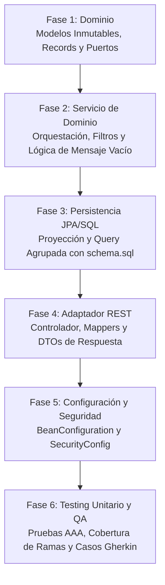

# 📋 Plan de Implementación · HU-24: Análisis de Clientes con Mayor Número de Inasistencias

**Historia de Usuario:** HU-24  
**Módulo:** Métricas y Reportería de Proveedor  
**Rol:** Proveedor  
**Arquitectura:** Hexagonal (Ports & Adapters)  
**Proyecto:** Bookify

---

## 1. Definición de la Historia de Usuario

### 1.1 Enunciado
> **Como** proveedor,  
> **quiero** identificar los clientes que acumulan más inasistencias en mi negocio,  
> **para** reconocer patrones de incumplimiento y tomar medidas preventivas.

---

### 1.2 Criterios de Aceptación (Escenarios Gherkin)

```gherkin
Scenario: Consultar clientes con más inasistencias
  Given que soy un proveedor autenticado
  And existen reservas marcadas como "no asistió"
  When consulto el análisis de inasistencias de un periodo
  Then el sistema muestra los clientes con inasistencias
  And presenta el número de inasistencias de cada cliente
  And ordena los resultados de mayor a menor cantidad

Scenario: Excluir reservas canceladas
  Given que un cliente tiene reservas canceladas
  When consulto sus inasistencias
  Then el sistema no contabiliza esas cancelaciones

Scenario: Proteger información entre negocios
  Given que soy un proveedor autenticado
  When consulto las inasistencias por cliente
  Then el sistema muestra únicamente datos de mi negocio

Scenario: Consultar periodo sin inasistencias
  Given que no existen inasistencias registradas en el periodo
  When consulto el análisis por cliente
  Then el sistema informa que no existen inasistencias
```

---

## 2. Decisiones de Diseño y Alineación con `schema.sql`

El diseño se sustenta de forma directa en las tablas y relaciones definidas en `schema.sql`:

1. **Alineación con el Modelo Relacional (`schema.sql`):**
   * **`tbl_usuario`:** Identifica al cliente a través de `id_usuario (UUID)`, `nombres`, `apellidos`, `correo` y `telefono`.
   * **`tbl_reserva`:** Vincula al cliente con la cita mediante `id_cliente` (FK hacia `tbl_usuario`), el servicio mediante `id_servicio` (FK hacia `tbl_servicio`), la disponibilidad mediante `id_disponibilidad` (FK hacia `tbl_disponibilidad`), y el estado mediante `id_estado_reserva` (FK hacia `tbl_estado_reserva`).
   * **`tbl_servicio`:** Contiene `id_proveedor` (FK hacia `tbl_proveedor`). Permite filtrar directamente por el negocio del proveedor sin navegaciones intermedias.
   * **`tbl_proveedor_usuario`:** Mapea el `userId` autenticado del token JWT al `id_proveedor` del negocio, garantizando el aislamiento multicomercio exigido por el escenario *"Proteger información entre negocios"*.
   * **`tbl_disponibilidad`:** Contiene `inicio_at` (`timestamp with time zone`), utilizado para delimitar el periodo de consulta (`fechaInicio` a `fechaFin`).
2. **Criterio Estricto de Inasistencia:**
   * Solo se contabilizan reservas con estado `er.codigo = 'NO_ASISTIO'`.
   * Las reservas canceladas (`er.codigo = 'CANCELADA'`), confirmadas (`CONFIRMADA`) o atendidas (`ATENDIDA`) **quedan automáticamente excluidas**.
3. **Ordenamiento de Negocio:**
   * La lista se ordena de forma descendente por la cantidad de inasistencias (`ORDER BY totalInasistencias DESC, nombreCompleto ASC`).
4. **Zona Horaria:**
   * Normalización a `ZoneId.of("America/Bogota")` para delimitar los días `[00:00:00, 23:59:59.999999]`.
5. **Endpoint REST propuesto:**
   ```http
   GET /api/v1/comercio/metricas/inasistencias/clientes?fechaInicio=2026-10-01&fechaFin=2026-10-31
   ```
   *Razón:* Se agrupa naturalmente bajo la ruta de métricas de inasistencia del comercio (`/api/v1/comercio/**`), protegida por `.hasAuthority("PROVEEDOR")` en `SecurityConfig`.

---

## 3. Contratos de la API REST

### 3.1 Endpoint
* **Método:** `GET`
* **Ruta:** `/api/v1/comercio/metricas/inasistencias/clientes`
* **Cabecera requerida:** `Authorization: Bearer <JWT_PROVEEDOR>`
* **Parámetros de consulta (Query Params):**
  * `fechaInicio` (obligatorio, formato ISO `YYYY-MM-DD`, ej. `2026-10-01`)
  * `fechaFin` (obligatorio, formato ISO `YYYY-MM-DD`, ej. `2026-10-31`)
  * `limite` (opcional, entero positivo, ej. `10` para top 10; por defecto sin límite o 50)

---

### 3.2 Respuestas HTTP

#### Caso A: Clientes con inasistencias en el periodo (Escenarios 1, 2 y 3) — `200 OK`
```json
{
  "proveedorId": "c3b9b46e-1d52-4756-8a03-75c1284d7201",
  "fechaInicio": "2026-10-01",
  "fechaFin": "2026-10-31",
  "totalClientes": 2,
  "clientes": [
    {
      "clienteId": "a1b2c3d4-e5f6-7a8b-9c0d-1e2f3a4b5c6d",
      "nombre": "Carlos Andrés Pérez",
      "correo": "carlos.perez@example.com",
      "telefono": "+573001234567",
      "inasistencias": 4
    },
    {
      "clienteId": "b2c3d4e5-f6a7-8b9c-0d1e-2f3a4b5c6d7e",
      "nombre": "Mariana Gómez",
      "correo": "mariana.gomez@example.com",
      "telefono": "+573109876543",
      "inasistencias": 2
    }
  ],
  "mensaje": null
}
```

#### Caso B: Periodo sin inasistencias (Escenario 4) — `200 OK`
```json
{
  "proveedorId": "c3b9b46e-1d52-4756-8a03-75c1284d7201",
  "fechaInicio": "2026-10-01",
  "fechaFin": "2026-10-31",
  "totalClientes": 0,
  "clientes": [],
  "mensaje": "No existen inasistencias registradas en el periodo seleccionado."
}
```

#### Caso C: Errores de Validación o Autorización
* **`400 Bad Request`:** Fechas ausentes, formato erróneo o `fechaInicio > fechaFin`:
  ```json
  { "error": "La fecha de inicio no puede ser posterior a la fecha de fin" }
  ```
* **`401 Unauthorized`:** Token JWT ausente o inválido.
* **`403 Forbidden`:** Usuario no es `PROVEEDOR` o no cuenta con perfil comercial en `tbl_proveedor_usuario`.

---

## 4. Fases de Implementación Paso a Paso



---

### Fase 1: Dominio (Modelos y Puertos)

1. **Modelo de Cliente con Inasistencias:**
   * Archivo: `domain/model/ClientNoShowSummary.java`
     ```java
     package udea.fabrica.bookify.domain.model;
     import java.util.UUID;

     public record ClientNoShowSummary(
         UUID clienteId,
         String nombre,
         String correo,
         String telefono,
         long inasistencias
     ) {}
     ```

2. **Modelo del Reporte Agrupado:**
   * Archivo: `domain/model/ClientNoShowReport.java`
     ```java
     package udea.fabrica.bookify.domain.model;
     import java.time.LocalDate;
     import java.util.List;
     import java.util.UUID;

     public record ClientNoShowReport(
         UUID providerId,
         LocalDate fechaInicio,
         LocalDate fechaFin,
         List<ClientNoShowSummary> clientes,
         String mensaje
     ) {
         public int totalClientes() {
             return clientes != null ? clientes.size() : 0;
         }
     }
     ```

3. **Puerto de Entrada (Caso de Uso):**
   * Archivo: `domain/port/in/GetClientNoShowReportUseCase.java`
     ```java
     package udea.fabrica.bookify.domain.port.in;
     import java.time.LocalDate;
     import java.util.UUID;
     import udea.fabrica.bookify.domain.model.ClientNoShowReport;

     public interface GetClientNoShowReportUseCase {
         ClientNoShowReport getReport(UUID authenticatedUserId, LocalDate fechaInicio, LocalDate fechaFin, Integer limite);
     }
     ```

4. **Puerto de Salida (Repositorio):**
   * Archivo: `domain/port/out/ClientNoShowOutputPort.java`
     ```java
     package udea.fabrica.bookify.domain.port.out;
     import java.time.OffsetDateTime;
     import java.util.List;
     import java.util.UUID;
     import udea.fabrica.bookify.domain.model.ClientNoShowSummary;

     public interface ClientNoShowOutputPort {
         List<ClientNoShowSummary> findClientsWithMostNoShows(
             UUID providerId,
             OffsetDateTime startDateTime,
             OffsetDateTime endDateTime,
             Integer limite
         );
     }
     ```

---

### Fase 2: Servicio de Dominio (Lógica de Negocio)

* **Archivo:** `domain/service/ClientNoShowService.java`
* **Implementa:** `GetClientNoShowReportUseCase`
* **Dependencias:** `ClientNoShowOutputPort`, `MerchantProfileRepositoryPort`

**Lógica implementada:**
1. **Resolver comercio del usuario autenticado:**
   * Consulta `merchantProfileRepository.findByUserId(authenticatedUserId)`.
   * Si no existe $\rightarrow$ lanza `DomainForbiddenException("El usuario no tiene un perfil comercial registrado.")`.
2. **Validar rango temporal:**
   * Si `fechaInicio.isAfter(fechaFin)` $\rightarrow$ lanza `IllegalArgumentException("La fecha de inicio no puede ser posterior a la fecha de fin.")`.
3. **Conversión de fechas con zona horaria oficial:**
   * `ZoneId zone = ZoneId.of("America/Bogota");`
   * `startDateTime = fechaInicio.atStartOfDay(zone).toOffsetDateTime();`
   * `endDateTime = fechaFin.atTime(LocalTime.MAX).atZone(zone).toOffsetDateTime();`
4. **Consulta al puerto de salida:**
   * Invoca `clientNoShowOutputPort.findClientsWithMostNoShows(...)`.
5. **Generar reporte:**
   * Si la lista de clientes es vacía $\rightarrow$ retorna el reporte con `mensaje = "No existen inasistencias registradas en el periodo seleccionado."` y lista vacía `List.of()`.
   * Si contiene clientes $\rightarrow$ retorna el reporte con `mensaje = null` y la lista ordenada.

---

### Fase 3: Persistencia (Adaptador JPA / SQL Nativo)

1. **Consulta SQL Optimizada (Basada en `schema.sql`):**
   ```sql
   SELECT 
       u.id_usuario AS clienteId,
       TRIM(CONCAT(u.nombres, ' ', COALESCE(u.apellidos, ''))) AS nombreCompleto,
       u.correo AS correo,
       u.telefono AS telefono,
       COUNT(r.id_reserva) AS inasistencias
   FROM tbl_reserva r
   INNER JOIN tbl_usuario u ON u.id_usuario = r.id_cliente
   INNER JOIN tbl_servicio s ON s.id_servicio = r.id_servicio
   INNER JOIN tbl_disponibilidad d ON d.id_disponibilidad = r.id_disponibilidad
   INNER JOIN tbl_estado_reserva er ON er.id_estado_reserva = r.id_estado_reserva
   WHERE s.id_proveedor = :proveedorId
     AND er.codigo = 'NO_ASISTIO'
     AND d.inicio_at >= :startDateTime
     AND d.inicio_at <= :endDateTime
   GROUP BY u.id_usuario, u.nombres, u.apellidos, u.correo, u.telefono
   ORDER BY inasistencias DESC, nombreCompleto ASC
   LIMIT :limite;
   ```

2. **Proyección Spring Data JPA:**
   * Archivo: `infrastructure/adapter/output/persistence/repository/ClientNoShowProjection.java`
     ```java
     public interface ClientNoShowProjection {
         UUID getClienteId();
         String getNombreCompleto();
         String getCorreo();
         String getTelefono();
         long getInasistencias();
     }
     ```

3. **Adaptador de Persistencia:**
   * Archivo: `infrastructure/adapter/output/persistence/adapter/ClientNoShowPersistenceAdapter.java`
   * Mapea la proyección a `ClientNoShowSummary`.

---

### Fase 4: Adaptador REST (Controlador, DTOs y Mappers)

1. **DTOs de Respuesta REST:**
   * `ClientNoShowItemDto.java`:
     ```java
     public record ClientNoShowItemDto(
         UUID clienteId,
         String nombre,
         String correo,
         String telefono,
         long inasistencias
     ) {}
     ```
   * `ClientNoShowReportResponseDto.java`:
     ```java
     public record ClientNoShowReportResponseDto(
         UUID proveedorId,
         LocalDate fechaInicio,
         LocalDate fechaFin,
         int totalClientes,
         List<ClientNoShowItemDto> clientes,
         String mensaje
     ) {}
     ```

2. **Controlador REST:**
   * Archivo: `infrastructure/adapter/input/rest/controller/MerchantClientNoShowController.java`
     ```java
     @RestController
     @RequestMapping("/api/v1/comercio/metricas/inasistencias")
     public class MerchantClientNoShowController {

         private final GetClientNoShowReportUseCase getClientNoShowReportUseCase;

         public MerchantClientNoShowController(GetClientNoShowReportUseCase useCase) {
             this.getClientNoShowReportUseCase = useCase;
         }

         @GetMapping("/clientes")
         public ResponseEntity<ClientNoShowReportResponseDto> getClientsWithMostNoShows(
                 @RequestParam("fechaInicio") @DateTimeFormat(iso = DateTimeFormat.ISO.DATE) LocalDate fechaInicio,
                 @RequestParam("fechaFin") @DateTimeFormat(iso = DateTimeFormat.ISO.DATE) LocalDate fechaFin,
                 @RequestParam(value = "limite", required = false, defaultValue = "50") Integer limite,
                 Authentication authentication) {

             UUID userId = UUID.fromString(authentication.getName());
             ClientNoShowReport report = getClientNoShowReportUseCase.getReport(userId, fechaInicio, fechaFin, limite);

             return ResponseEntity.ok(ClientNoShowRestMapper.toDto(report));
         }
     }
     ```

---

### Fase 5: Configuración y Seguridad

1. **Registro en `BeanConfiguration.java`:**
   ```java
   @Bean
   public GetClientNoShowReportUseCase getClientNoShowReportUseCase(
           ClientNoShowOutputPort clientNoShowOutputPort,
           MerchantProfileRepositoryPort merchantProfileRepositoryPort) {
       return new ClientNoShowService(clientNoShowOutputPort, merchantProfileRepositoryPort);
   }
   ```

2. **Seguridad (`SecurityConfig.java`):**
   * Queda cubierto automáticamente bajo:
     ```java
     .requestMatchers("/api/v1/comercio/**").hasAuthority("PROVEEDOR")
     ```

---

## 5. Matriz de Trazabilidad: Escenarios Gherkin vs Pruebas

| Escenario Gherkin | Prueba Unitaria / Integración | Condición / Entrada | Resultado Esperado |
|---|---|---|---|
| **Consultar clientes con más inasistencias** | `ClientNoShowServiceTest#shouldReturnClientsOrderedByNoShowsDesc` | Cliente A: 4 inasistencias, Cliente B: 2 inasistencias | Lista con `[Cliente A (4), Cliente B (2)]`, orden descendente, `mensaje = null`. |
| **Excluir reservas canceladas** | `ClientNoShowServiceTest#shouldNotCountCancelledBookings` | Cliente tiene 3 canceladas y 1 `NO_ASISTIO` | Solo se contabiliza 1 inasistencia para el cliente. |
| **Proteger información entre negocios** | `ClientNoShowServiceTest#shouldOnlyIncludeBookingsOfAuthenticatedMerchant` | Reservas del Negocio 1 y Negocio 2 | El resultado solo contiene reservas vinculadas a `s.id_proveedor = :proveedorAutenticado`. |
| **Consultar periodo sin inasistencias** | `ClientNoShowServiceTest#shouldReturnMessageWhenNoNoShowsInPeriod` | 0 reservas en estado `NO_ASISTIO` | `clientes: []`, `totalClientes: 0`, `mensaje: "No existen inasistencias registradas en el periodo seleccionado."` |
| **Rango de fechas inválido** | `ClientNoShowServiceTest#shouldThrowWhenStartDateAfterEndDate` | `fechaInicio = 2026-10-31`, `fechaFin = 2026-10-01` | Lanza `IllegalArgumentException` $\rightarrow$ HTTP 400 Bad Request. |
| **Intento de acceso por no proveedor** | `MerchantClientNoShowControllerTest#shouldReturnForbiddenForNonMerchant` | Token de usuario sin comercio en `tbl_proveedor_usuario` | HTTP 403 Forbidden. |

---

## 6. Estrategia de Testing y Verificación de Calidad

### 6.1 Pruebas Unitarias (JUnit 5 + Mockito + AAA)
* Archivo: `src/test/java/udea/fabrica/bookify/domain/service/ClientNoShowServiceTest.java`.
* Pruebas para:
  * Ordenamiento estricto descendente.
  * Comprobación del mensaje cuando la lista está vacía.
  * Validaciones de fechas (`fechaInicio > fechaFin` y parámetros nulos).
  * Validación de rol y perfil de comercio inexistente.

### 6.2 Pruebas de Integración y Colección Postman (QA)
* Colección `Bookify-HU24-Clientes-Inasistencias.postman_collection.json`:
  1. `CP-HU24-01`: Consulta exitosa con múltiples clientes ordenados por inasistencias DESC.
  2. `CP-HU24-02`: Verificación de exclusión de reservas canceladas en la cuenta del cliente.
  3. `CP-HU24-03`: Validación de aislamiento multicomercio (Proveedor A no ve inasistencias ocurridas en Proveedor B).
  4. `CP-HU24-04`: Periodo sin inasistencias $\rightarrow$ valida HTTP 200, array vacío y mensaje informativo.
  5. `CP-HU24-05`: Rechazo con HTTP 400 si `fechaInicio > fechaFin`.
  6. `CP-HU24-06`: Intento de consulta sin token o con rol CLIENTE (HTTP 401 / 403).

### 6.3 Verificación de Reglas SonarCloud
* Constante para el mensaje `"No existen inasistencias registradas en el periodo seleccionado."` para evitar `java:S1192`.
* Uso explícito de `ZoneId.of("America/Bogota")` para evitar `java:S8688`.
* Complejidad ciclomática menor a 6 en el servicio de dominio.

---

## 7. Plan de Pruebas de Endpoints (Casos de Prueba con Datos y Resultados Esperados)

### 7.1 Requisitos y Precondiciones del Entorno

1. **Variables de Postman / Entorno:**
   * `baseUrl`: `http://localhost:8080` (o ambiente desplegado en Render).
   * `tokenProveedorA`: Token JWT con rol `PROVEEDOR` vinculado al comercio A.
   * `tokenProveedorB`: Token JWT con rol `PROVEEDOR` vinculado al comercio B.
   * `tokenCliente`: Token JWT con rol `CLIENTE`.

2. **Obtención de Tokens vía Login:**
   ```bash
   curl -X POST "{{baseUrl}}/api/v1/auth/login" \
     -H "Content-Type: application/json" \
     -d '{"correo": "proveedorA@bookify.com", "password": "Password123*"}'
   ```

3. **Script SQL de Verificación de Inasistencias por Cliente:**
   ```sql
   SELECT 
       u.id_usuario,
       CONCAT(u.nombres, ' ', COALESCE(u.apellidos, '')) AS cliente,
       u.correo,
       COUNT(r.id_reserva) AS total_inasistencias
   FROM tbl_reserva r
   JOIN tbl_usuario u ON u.id_usuario = r.id_cliente
   JOIN tbl_servicio s ON s.id_servicio = r.id_servicio
   JOIN tbl_disponibilidad d ON d.id_disponibilidad = r.id_disponibilidad
   JOIN tbl_estado_reserva er ON er.id_estado_reserva = r.id_estado_reserva
   WHERE s.id_proveedor = 'c3b9b46e-1d52-4756-8a03-75c1284d7201' -- Proveedor A
     AND er.codigo = 'NO_ASISTIO'
     AND d.inicio_at >= '2026-10-01T00:00:00-05:00'
     AND d.inicio_at <= '2026-10-31T23:59:59-05:00'
   GROUP BY u.id_usuario, u.nombres, u.apellidos, u.correo
   ORDER BY total_inasistencias DESC;
   ```

---

### 7.2 Casos de Prueba Detallados

#### CP-HU24-01 · Consultar clientes con más inasistencias (Escenario 1)
* **Escenario Gherkin:** *Consultar clientes con más inasistencias*
* **Precondición:** En el periodo `2026-10-01` a `2026-10-31`:
  * El Cliente Carlos Pérez (`id_usuario = a1b2c3d4-e5f6-7a8b-9c0d-1e2f3a4b5c6d`) acumula 4 inasistencias (`NO_ASISTIO`).
  * La Clienta Mariana Gómez (`id_usuario = b2c3d4e5-f6a7-8b9c-0d1e-2f3a4b5c6d7e`) acumula 2 inasistencias (`NO_ASISTIO`).
* **Petición HTTP:**
  ```http
  GET {{baseUrl}}/api/v1/comercio/metricas/inasistencias/clientes?fechaInicio=2026-10-01&fechaFin=2026-10-31
  Authorization: Bearer {{tokenProveedorA}}
  ```
* **Comando curl:**
  ```bash
  curl -X GET "{{baseUrl}}/api/v1/comercio/metricas/inasistencias/clientes?fechaInicio=2026-10-01&fechaFin=2026-10-31" \
    -H "Authorization: Bearer {{tokenProveedorA}}"
  ```
* **Resultado Esperado:**
  * **Código HTTP:** `200 OK`
  * **Cuerpo de Respuesta:**
    ```json
    {
      "proveedorId": "c3b9b46e-1d52-4756-8a03-75c1284d7201",
      "fechaInicio": "2026-10-01",
      "fechaFin": "2026-10-31",
      "totalClientes": 2,
      "clientes": [
        {
          "clienteId": "a1b2c3d4-e5f6-7a8b-9c0d-1e2f3a4b5c6d",
          "nombre": "Carlos Andrés Pérez",
          "correo": "carlos.perez@example.com",
          "telefono": "+573001234567",
          "inasistencias": 4
        },
        {
          "clienteId": "b2c3d4e5-f6a7-8b9c-0d1e-2f3a4b5c6d7e",
          "nombre": "Mariana Gómez",
          "correo": "mariana.gomez@example.com",
          "telefono": "+573109876543",
          "inasistencias": 2
        }
      ],
      "mensaje": null
    }
    ```
  * **Validación de Regla:** Los clientes se presentan ordenados de mayor a menor cantidad de inasistencias ($4 \ge 2$).

---

#### CP-HU24-02 · Excluir reservas canceladas del conteo de cada cliente (Escenario 2)
* **Escenario Gherkin:** *Excluir reservas canceladas*
* **Precondición:** El cliente Juan Torres tiene 3 reservas `CANCELADA` y 1 reserva `NO_ASISTIO` con el Proveedor A en el periodo.
* **Petición HTTP:**
  ```http
  GET {{baseUrl}}/api/v1/comercio/metricas/inasistencias/clientes?fechaInicio=2026-10-01&fechaFin=2026-10-31
  Authorization: Bearer {{tokenProveedorA}}
  ```
* **Comando curl:**
  ```bash
  curl -X GET "{{baseUrl}}/api/v1/comercio/metricas/inasistencias/clientes?fechaInicio=2026-10-01&fechaFin=2026-10-31" \
    -H "Authorization: Bearer {{tokenProveedorA}}"
  ```
* **Resultado Esperado:**
  * **Código HTTP:** `200 OK`
  * **Cuerpo de Respuesta:**
    El cliente Juan Torres aparece en la lista con `inasistencias: 1`. Las 3 reservas canceladas **no se contabilizan**.

---

#### CP-HU24-03 · Proteger información entre negocios (Aislamiento Multicomercio - Escenario 3)
* **Escenario Gherkin:** *Proteger información entre negocios*
* **Precondición:** El cliente Carlos Pérez tiene 4 inasistencias en el Proveedor A y 3 inasistencias en el Proveedor B.
* **Petición HTTP con Proveedor A:**
  ```http
  GET {{baseUrl}}/api/v1/comercio/metricas/inasistencias/clientes?fechaInicio=2026-10-01&fechaFin=2026-10-31
  Authorization: Bearer {{tokenProveedorA}}
  ```
* **Petición HTTP con Proveedor B:**
  ```http
  GET {{baseUrl}}/api/v1/comercio/metricas/inasistencias/clientes?fechaInicio=2026-10-01&fechaFin=2026-10-31
  Authorization: Bearer {{tokenProveedorB}}
  ```
* **Resultados Esperados:**
  * Para **Proveedor A (`200 OK`):** Carlos Pérez tiene `inasistencias: 4`.
  * Para **Proveedor B (`200 OK`):** Carlos Pérez tiene `inasistencias: 3`.
  * **Validación de Regla:** Cada proveedor observa únicamente los datos e inasistencias generados en su propio negocio.

---

#### CP-HU24-04 · Consultar periodo sin inasistencias (Escenario 4)
* **Escenario Gherkin:** *Consultar periodo sin inasistencias*
* **Precondición:** En el periodo `2026-02-01` a `2026-02-28` el Proveedor A no registró ninguna cita con estado `NO_ASISTIO`.
* **Petición HTTP:**
  ```http
  GET {{baseUrl}}/api/v1/comercio/metricas/inasistencias/clientes?fechaInicio=2026-02-01&fechaFin=2026-02-28
  Authorization: Bearer {{tokenProveedorA}}
  ```
* **Comando curl:**
  ```bash
  curl -X GET "{{baseUrl}}/api/v1/comercio/metricas/inasistencias/clientes?fechaInicio=2026-02-01&fechaFin=2026-02-28" \
    -H "Authorization: Bearer {{tokenProveedorA}}"
  ```
* **Resultado Esperado:**
  * **Código HTTP:** `200 OK`
  * **Cuerpo de Respuesta:**
    ```json
    {
      "proveedorId": "c3b9b46e-1d52-4756-8a03-75c1284d7201",
      "fechaInicio": "2026-02-01",
      "fechaFin": "2026-02-28",
      "totalClientes": 0,
      "clientes": [],
      "mensaje": "No existen inasistencias registradas en el periodo seleccionado."
    }
    ```

---

#### CP-HU24-05 · Límite de resultados (Paginación / Top N)
* **Petición HTTP:**
  ```http
  GET {{baseUrl}}/api/v1/comercio/metricas/inasistencias/clientes?fechaInicio=2026-10-01&fechaFin=2026-10-31&limite=1
  Authorization: Bearer {{tokenProveedorA}}
  ```
* **Resultado Esperado:**
  * **Código HTTP:** `200 OK`
  * **Cuerpo de Respuesta:** Retorna únicamente el top 1 cliente con mayor número de inasistencias (`totalClientes: 1`).

---

#### CP-HU24-06 · Error de validación: Fechas invertidas
* **Petición HTTP:**
  ```http
  GET {{baseUrl}}/api/v1/comercio/metricas/inasistencias/clientes?fechaInicio=2026-10-31&fechaFin=2026-10-01
  Authorization: Bearer {{tokenProveedorA}}
  ```
* **Resultado Esperado:**
  * **Código HTTP:** `400 Bad Request`
  * **Cuerpo de Respuesta:**
    ```json
    {
      "error": "La fecha de inicio no puede ser posterior a la fecha de fin."
    }
    ```

---

#### CP-HU24-07 · Error de validación: Límite menor o igual a cero
* **Petición HTTP:**
  ```http
  GET {{baseUrl}}/api/v1/comercio/metricas/inasistencias/clientes?fechaInicio=2026-10-01&fechaFin=2026-10-31&limite=0
  Authorization: Bearer {{tokenProveedorA}}
  ```
* **Resultado Esperado:**
  * **Código HTTP:** `400 Bad Request`
  * **Cuerpo de Respuesta:**
    ```json
    {
      "error": "El límite debe ser un entero positivo."
    }
    ```

---

#### CP-HU24-08 · Control de acceso - Cliente intenta consultar inasistencias de clientes
* **Petición HTTP:** Con `Authorization: Bearer {{tokenCliente}}`.
* **Resultado Esperado:**
  * **Código HTTP:** `403 Forbidden`

---

#### CP-HU24-09 · Petición no autenticada
* **Petición HTTP:** Sin cabecera `Authorization`.
* **Resultado Esperado:**
  * **Código HTTP:** `401 Unauthorized`


